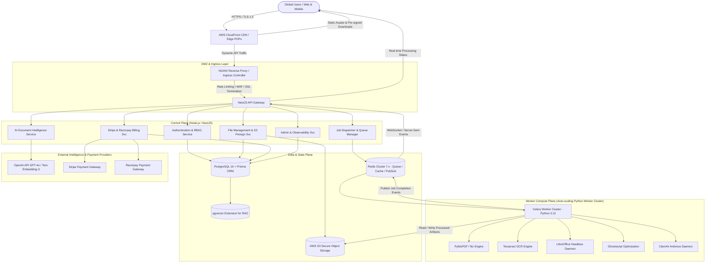
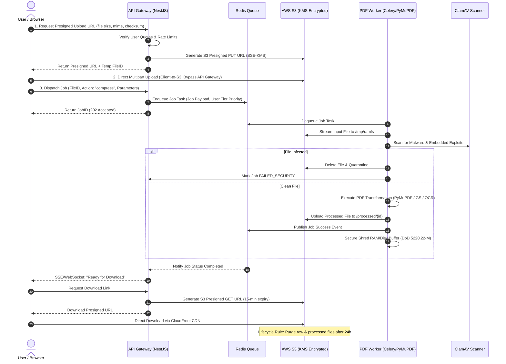
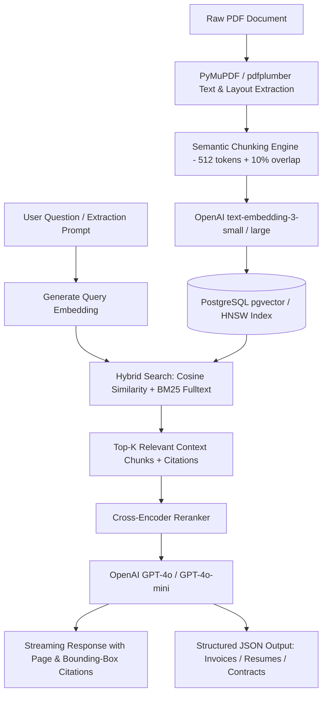

# PDFForge AI – Enterprise PDF Intelligence Platform
## Complete System Architecture & Engineering Blueprint

---

### 1. Executive Summary & Architectural Overview

PDFForge AI is an enterprise-grade cloud-native PDF processing and document intelligence SaaS platform engineered to process high-throughput document workloads (millions of users and billions of pages per month). It integrates traditional deterministic document manipulation (rasterization, lossless compression, OCR, conversion) with non-deterministic Generative AI (RAG, semantic search, structured extraction, automated compliance analysis).

The system is architected as an asynchronous event-driven microservices ecosystem decoupled via Redis/Celery message brokers, backed by distributed object storage (AWS S3 with CloudFront CDN), a relational PostgreSQL transactional engine, and an ephemeral processing cluster.

---

### 2. Microservices Topology & Boundaries

| Service Component | Technology Stack | Core Responsibilities | Scaling Model |
| :--- | :--- | :--- | :--- |
| **Web Frontend** | Next.js 15, React 19, TypeScript, Tailwind | User interfaces, drag-and-drop studio, interactive AI viewer, dashboard, responsive mobile layout | Horizontal (HPA 3–20 pods, Edge SSR) |
| **API Gateway** | NestJS, TypeScript, Fastify/Express | Ingress routing, JWT authentication, RBAC authorization, GraphQL & REST, rate limiting, S3 presigned URL generation | Horizontal (HPA 5–30 pods, stateless) |
| **File Service** | NestJS, AWS SDK v3, ClamAV Client | Multipart uploads, presigned link negotiation, chunk validation, ephemeral file shredding, metadata harvesting | Horizontal (HPA 3–15 pods) |
| **Job Queue & Dispatcher** | NestJS, BullMQ, Redis Cluster | Task prioritization, tier-based QoS scheduling, failure retries, progress telemetry streaming via SSE | Horizontal (HPA 3–10 pods) |
| **PDF Processing Engine** | Python 3.12, FastAPI, Celery, PyMuPDF, Ghostscript, LibreOffice | Heavy CPU/Memory bound PDF manipulation, vector rendering, OCR, Office-to-PDF conversion | Dynamic HPA based on Celery Queue Backlog (5–100+ pods) |
| **AI Intelligence Engine**| Python / NestJS, LangChain, pgvector, OpenAI API | Document chunking, dense vector embeddings, RAG query pipelines, JSON schema structured entity extraction | Horizontal (HPA 3–15 pods) |
| **Billing & Quota Service**| NestJS, Stripe SDK, Razorpay SDK | Plan quotas, subscription lifecycle, webhook idempotency, metered billing, automated invoice generation | Multi-region redundant (Active-Passive) |

---

### 3. File Processing & Ephemeral Security Lifecycle

To adhere to enterprise compliance (GDPR, HIPAA, SOC2 Type II), PDFForge AI operates a **Zero-Permanent-Storage Principle** for non-archived user documents:

---

### 4. Enterprise RAG Pipeline (AI PDF Assistant & Document Intelligence)

---

### 5. Multi-Tenant Organization & Access Control (RBAC)

PDFForge AI enforces a hierarchical multi-tenant structure:
- **Platform SuperAdmin**: Global system monitoring, telemetry, abuse flags, tenant overrides.
- **Organization Owner**: Billing, plan upgrades, enterprise SSO configuration, API key generation.
- **Organization Admin**: Member invitations, workspace management, team quotas.
- **Member**: Create, execute, and view document jobs in shared or private workspaces.
- **Viewer**: Read-only access to team documents, shared reports, and extracted metadata.

---

### 6. High Availability & Fault Tolerance Strategy

1. **Idempotent Job Processing**: Every processing request is tagged with a deterministic `Idempotency-Key`. Retries do not create duplicate artifacts.
2. **Graceful Degradation**: If OCR worker nodes encounter high queue latency, conversions and simple compressions are routed to prioritized low-latency pools.
3. **Queue Prioritization**:
   - `queue_enterprise`: Concurrency 100+, latency SLA < 2s.
   - `queue_pro`: Concurrency 50+, latency SLA < 5s.
   - `queue_free`: Concurrency 20+, best-effort scheduling.
4. **Disaster Recovery**: Multi-AZ PostgreSQL Aurora deployment with automated snapshots every 6 hours and S3 Cross-Region Replication (CRR).
