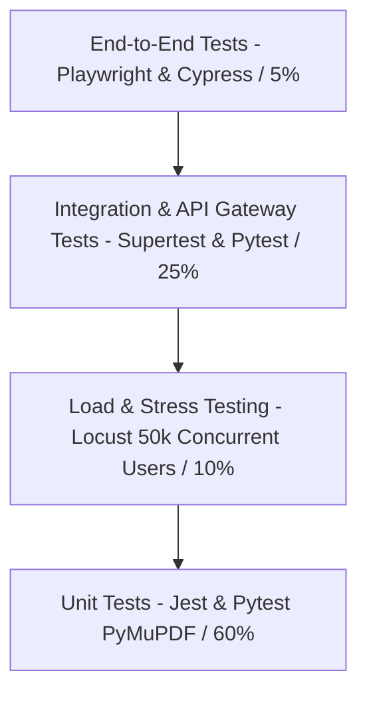

# PDFForge AI – Enterprise Testing Strategy & Load Verification
## Multi-Tier Quality Assurance, E2E Automation & High-Concurrency Benchmarking

---

### 1. Multi-Tier Testing Pyramid



---

### 2. High-Concurrency Load Testing Script (Locust)

This Locust benchmark simulates 50,000 active concurrent users executing document uploads, compression jobs, and AI Q&A requests against the cluster:

```python
import uuid
import random
from locust import HttpUser, task, between

class PDFForgeLoadUser(HttpUser):
    wait_time = between(1, 3)

    def on_start(self):
        # Authenticate simulated user session
        response = self.client.post("/api/v1/auth/login", json={
            "email": f"load_user_{random.randint(1, 10000)}@test.pdfforge.ai",
            "password": "Password123!"
        })
        if response.status_code == 200:
            token = response.json().get("tokens", {}).get("accessToken")
            self.headers = {"Authorization": f"Bearer {token}"}
        else:
            self.headers = {}

    @task(5)
    def test_compress_pdf_workflow(self):
        # 1. Presign
        file_id = str(uuid.uuid4())
        res = self.client.post("/api/v1/files/presign-upload", json={
            "fileName": "large_report.pdf",
            "fileSizeBytes": 4500000,
            "mimeType": "application/pdf",
            "checksumSha256": "e3b0c44298fc1c149afbf4c8996fb92427ae41e4649b934ca495991b7852b855"
        }, headers=self.headers)

        if res.status_code == 200:
            fid = res.json().get("fileId")
            # 2. Dispatch compression job
            job_res = self.client.post("/api/v1/pdf/jobs", json={
                "tool": "compress",
                "fileIds": [fid],
                "parameters": {"compressionLevel": "medium"}
            }, headers=self.headers)

            if job_res.status_code in [200, 201, 202]:
                job_id = job_res.json().get("jobId")
                # 3. Poll job status
                self.client.get(f"/api/v1/pdf/jobs/{job_id}", headers=self.headers)

    @task(3)
    def test_ai_document_chat(self):
        self.client.post("/api/v1/ai/chat", json={
            "fileId": "mock_file_sample",
            "question": "What is the liability cap under Section 12?"
        }, headers=self.headers)

    @task(2)
    def test_health_telemetry(self):
        self.client.get("/api/v1/admin/telemetry", headers=self.headers)
```

Run load test:
```bash
locust -f tests/locustfile.py --headless -u 5000 -r 250 --run-time 10m --host http://localhost:4000
```

---

### 3. GitHub Actions Continuous Integration (CI/CD)

```yaml
name: PDFForge AI CI/CD Pipeline

on:
  push:
    branches: [main, develop]
  pull_request:
    branches: [main]

jobs:
  lint-and-test:
    runs-on: ubuntu-latest
    steps:
      - uses: actions/checkout@v4

      # Backend Test Matrix
      - name: Setup Node.js
        uses: actions/setup-node@v4
        with:
          node-version: 20
          cache: 'npm'
          cache-dependency-path: 'apps/api/package.json'

      - name: Install API Dependencies
        run: cd apps/api && npm ci

      - name: Run Prisma Validate
        run: cd apps/api && npx prisma validate

      - name: Run NestJS Unit Tests
        run: cd apps/api && npm run test

      # Python Worker Test Matrix
      - name: Setup Python
        uses: actions/setup-python@v5
        with:
          python-version: '3.12'

      - name: Install Python Dependencies
        run: |
          cd services/pdf-worker
          pip install -r requirements.txt
          pip install pytest

      - name: Run Worker Processor Tests
        run: |
          cd services/pdf-worker
          pytest tests/ -v
```
